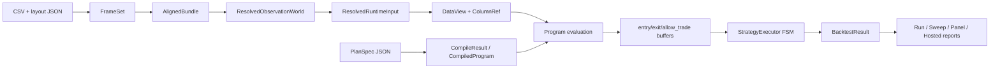

# Transformation Stages

| Stage | Thesis | Code location | Input state | Operation | Output state | Preserved invariant | Loss/compression | Reversibility | Risks |
| --- | --- | --- | --- | --- | --- | --- | --- | --- | --- |
| 1. Artifact load | Raw files become typed intent | `src/ingest/*`, `src/ingest/plan_spec.cpp` | CSV text, layout JSON, PlanSpec JSON | Parse CSV/schema/JSON into C++ structs | `DataSpec`, `LayoutSpec`, `PlanSpec`, raw tables | Artifact fields remain explicit | JSON/text formatting is lost | Partially reversible through reports and source paths | File format ambiguity, schema drift |
| 2. Preprocess | Rows become numeric frames | `preprocess_to_frameset` in `run_pipeline.cpp` | raw table and `DataSpec` | Select columns, coerce numeric values, build frames | `FrameSet`, `PreprocessReport` | Row-domain meaning is preserved by schema | Original raw text details may be lost | Partially reversible | Null/NaN/coercion assumptions |
| 3. Align | Series become a shared row domain | `align_frameset` in `run_pipeline.cpp` | one or more frames | Apply alignment/calendar policy | `AlignedBundle` | Aligned rows share a runtime index | Non-intersecting rows may be omitted under strict policies | Partially reversible with manifest/provenance | Ordering and calendar policy mistakes |
| 4. Mount capabilities | Observation world gains axes/topologies | `build_resolved_observation_world`, `DataView` | aligned bundle plus topology declarations | Mount built-in/declarative topologies and run manifest | `ResolvedObservationWorld`, `TopologyCatalog` | Capability metadata travels with data | Topology provider internals abstracted | Partially reversible | Missing topology or wrong query family |
| 5. Bind target | Ambiguous data becomes one run target | `bind_resolved_runtime_target` | observation world, primary column, target spec | Resolve series/entity/column | `ResolvedRuntimeInput`, `ColumnRef` | Primary binding is explicit | Only one active primary target per primary run | Reversible by changing target spec | Silent wrong target if author guesses poorly |
| 6. Compile plan | Strategy graph becomes executable slots | `compile_plan`, `CompiledProgram` | PlanSpec, registry, compile env | Validate ops/types/params, assign slots, bind signals, compile dynamic metadata | `CompileResult`, `StrategyPlan`, `CompiledProgram` | DAG semantics and signal bindings are preserved | Human node order collapses into topological slots | Partially reversible via compiler metadata | Registry metadata drift, unsupported op gaps |
| 7. Evaluate buffers | Graph nodes become row-aligned numeric/bool buffers | `evaluate_strategy_plan_program` | `DataView`, primary `ColumnRef`, compiled program | Execute kernels in deterministic order | signal buffers, dynamic execution summary | Row count and slot semantics remain stable | Intermediate buffers may be discarded after run | Not fully reversible | NaN/warmup/default signal mismatches |
| 8. Execute strategy | Signals become trades and metrics | `StrategyExecutor::run` | price columns, signal buffers, `ExecSettings` | FSM over rows: entries, exits, costs, timing, reversal, closeout | `BacktestResult` | Trade lifecycle follows settings | Detailed row buffers compressed into metrics/trade hash | Irreversible without retained signals | Same-bar/next-bar misunderstanding, branch-heavy edge cases |
| 9. Search or panel | Single run repeats across params/entities | `run_custom_plan_spec`, `panel_runner.cpp`, `sweep/*.cpp` | PlanSpec with sweep/run scope, aligned data | Candidate/entity iteration, ranking, report assembly | `PlanSweepReport` or `PanelReport` | Each candidate/entity uses same runtime contract | Candidate detail may be capped/summarized | Partially reversible through trace where captured | Partial failures, tie-breaking, cancellation |
| 10. Hosted lifecycle | Local runtime becomes a queued service job | `ServerRuntime`, `ProtocolDispatcher` | uploaded artifacts or catalog refs, session/job request | Validate, quota-check, queue, execute, retain result | job status/result, protocol response | Runtime result semantics remain local-compatible | Transport and store metadata are projections | Partially reversible through retained artifacts/results | Abuse policy, cancellation race, ownership bugs |

## Shape-Faithful Toy Example

| Step | Example |
| --- | --- |
| CSV row | `time=2024-01-02, close=101.5, volume=12000` |
| Layout/DataSpec | `close` is numeric, `time` is temporal axis, optional topology names are declared |
| DataView | `col({series:"sample", col:"close"}) -> span<double>` with aligned row count |
| PlanSpec node | `{ "id":"fast", "op":"ts.sma", "args":["close"], "params":{"n":5} }` |
| Compiled slot | `fast` maps to one numeric output slot over all rows |
| Signal | `entry_long[i] = true` only when the bound bool node is active and warmup permits |
| BacktestResult | metrics such as trade count, PnL, drawdown, signal counts, trade hash |

# End-To-End Transformation Chain

# Data Shape Glossary

| Term | Meaning | Example |
| --- | --- | --- |
| Artifact truth | Facts supplied by files or protocol payloads | CSV, layout JSON, PlanSpec JSON |
| Observation world | Parsed/aligned data plus topology/run manifest | `ResolvedObservationWorld` |
| Runtime input | Observation world bound to a primary target | `ResolvedRuntimeInput` with `primary_ref` |
| Runtime facade | Non-owning view of aligned data and capabilities | `DataView` |
| Strategy graph | Typed PlanSpec numeric/bool node DAG | `numeric_nodes`, `bool_nodes`, `bind` |
| Compiled slots | Topological row-buffer execution plan | `numeric_slot_count`, `evaluation_order` |
| Signal buffers | Final bool arrays consumed by executor | `entry_long`, `exit_long`, `allow_trade` |
| Report truth | Interpreted execution/search result | `RunReport`, `PlanSweepReport`, `PanelReport` |

# Candidate Visuals

| Stage | Visual | Purpose |
| --- | --- | --- |
| Artifact load to DataView | before/after table | Show raw CSV/JSON becoming typed runtime facts |
| Compile plan | DAG to slot map | Explain why operator metadata matters |
| Program evaluation | pipeline nodes with row-buffer lanes | Show deterministic vector execution |
| Strategy execution | state machine | Separate signal calculation from trade lifecycle |
| Sweep/panel | matrix of candidates/entities x rows | Show natural batching/GPU implications |
| Hosted lifecycle | sequence diagram | Show service controls around same runtime |
| Proof/risk | ledger cards | Keep evidence and caveats visible |
