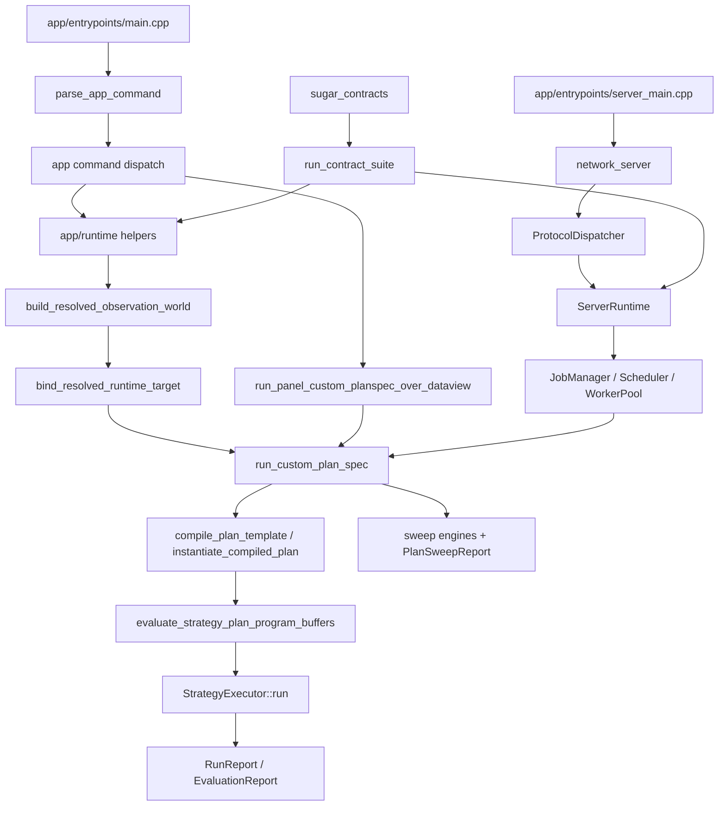

# Entry Points

| Name | File | How invoked | Expected inputs | Expected outputs |
| --- | --- | --- | --- | --- |
| `sugarbot` | `app/entrypoints/main.cpp` | CLI | commands such as `run`, `obs-report`, `plan-report`, `run-panel`, `dump-ops`, `interactive` | stdout/stderr report or diagnostics |
| `sugar_contracts` | `app/entrypoints/contract_main.cpp` | CLI/CTest | optional `--contract-section` keys | pass/fail exit code and contract output |
| `sugar_server` | `app/entrypoints/server_main.cpp` | CLI | network/server options | TCP service loop |
| `sugar_client` | `app/entrypoints/client_main.cpp` | CLI | client command args | framed request/response output |
| CTest tests | `CMakeLists.txt` | `ctest` | built test executables | named contract/app results |

# Main Orchestration Path

| Step | Function/class | Delegates to | Role |
| --- | --- | --- | --- |
| 1 | `parse_app_command` | app CLI parser | Parses user intent and command options |
| 2 | `run_unified_cli_command` or service submit path | app runtime or service runtime | Selects local run, report, panel, sweep, or hosted job flow |
| 3 | `build_resolved_observation_world` | preprocess, alignment, topology mounting | Builds data capability world |
| 4 | `bind_resolved_runtime_target` | DataView/ColumnRef resolution | Selects primary target |
| 5 | `run_custom_plan_spec` | plan compiler, evaluator, executor, sweep policy | Executes one plan or sweep |
| 6 | `compile_plan` / `instantiate_compiled_plan` | registry lookup, dynamic metadata validation | Produces executable program and signal bindings |
| 7 | `evaluate_strategy_plan_program` | op kernels and dynamic masks/gates | Produces signal buffers |
| 8 | `StrategyExecutor::run` | finite-state trade lifecycle | Produces `BacktestResult` |
| 9 | report builders/printers | evaluation/sweep/panel JSON/text writers | Presents result facts |

# Call Graph

| Caller | Callee | Role label |
| --- | --- | --- |
| `main.cpp` | `parse_app_command` | configuration |
| app commands | `build_resolved_observation_world` | orchestration |
| `build_resolved_observation_world` | `preprocess_to_frameset`, `align_frameset` | pure transformation plus file read |
| app/service runtime | `bind_resolved_runtime_target` | validation |
| `run_custom_plan_spec` | `build_compiled_plan_runtime_template` | orchestration |
| runtime adapter | `compile_plan_template` | validation/transformation |
| runtime adapter | `run_instantiated_plan_once` | orchestration |
| `run_instantiated_plan_once` | `evaluate_strategy_plan_program_buffers` | pure transformation |
| `run_instantiated_plan_once` | `StrategyExecutor::run` | execution transformation |
| sweep policies | trial evaluator | batching/search orchestration |
| `ProtocolDispatcher` | `ServerRuntime::submit_job` | side effect and validation |
| `ServerRuntime` | stores and job scheduler | side effect |

# Branching Logic

| Condition | Branch A | Branch B | Operational meaning | Risk |
| --- | --- | --- | --- | --- |
| CLI command kind | run/report/panel/interactive/etc. | error/help/default interactive | One executable fronts many adapters | App behavior can drift if command-specific validation differs |
| PlanSpec has `sweep.enabled` | run sweep policy and `PlanSweepReport` | run one strategy instance | Search is policy over same runtime | Candidate reporting can hide per-candidate failures if summaries are weak |
| Plan run scope is panel | iterate entities | primary-series run | Same PlanSpec over many targets | Missing primary columns must remain visible |
| Dynamic execution mode | compile/evaluate route metadata | static compiled graph | Bounded row-local route selection | Users may expect arbitrary dynamic graph mutation |
| Hosted intent | validate only | execute job | Allows preflight without running | Validation and execution must stay consistent |
| Service quota/abuse policy | reject/block/disconnect | accept | Prevents expensive or abusive hosted use | False positives can frustrate valid users; false negatives can overload service |
| Cancellation requested | terminal canceled state | continue | Cooperative cancellation | Long CPU sections must check cancellation often enough |

# Side Effects

| Category | Location | Behavior |
| --- | --- | --- |
| File system reads | ingest/app/service | CSV, layout, PlanSpec, catalog/demo files |
| File system writes | service stores, reports, build aliases | uploaded artifacts, job results, generated outputs, `SB` alias |
| Network | service network files | TCP framing, server sessions, client requests |
| Logging/output | app/reporting/service | diagnostics, reports, progress, security log callback |
| Mutation | service runtime | sessions, upload map, abuse state, jobs, results |
| Global-ish state | helper singletons/catalog construction | empty topology catalog helper and generated registries |

# Error And Fallback Paths

| Path | Behavior | Risk |
| --- | --- | --- |
| Parse failure | CLI/protocol returns explicit error | Low if errors remain specific |
| Missing column/axis/topology | validation fails or panel records entity failure | Medium; poor context can mislead plan authors |
| Unsupported op/backend | compiler/evaluator rejects unsupported node | Medium; registry/evaluator support must stay aligned |
| Dynamic route metadata invalid | compiler/evaluator rejects before or during execution | Medium; report language must explain declared bounds |
| Sweep candidate compile/run failure | report counts failures and last errors | Medium; summaries can mask distribution of failures |
| Hosted validation rejection | job can finish as rejected with metadata | Medium; rejected artifacts should remain explainable |
| Cancellation | service/executor/sweep routes to canceled state | Medium; cancellation granularity depends on checks |

# Concurrency Or Batching

| Location | Unit of work | Ordering assumptions | Determinism risks |
| --- | --- | --- | --- |
| Sweep engines | candidate indices or adaptive proposals | Candidate order and trace policy define reproducibility | Random/Monte Carlo seeds and dedupe must be reported |
| Panel runner | entity/series iteration | Series key order affects tie presentation | Tie-break and missing entity behavior |
| Hosted service | job queue and worker pool | Scheduler fairness and session ownership | Race conditions around cancel/result retrieval |
| Future GPU path | candidate/entity batches | Host merge must preserve ranking/tie semantics | Numeric tolerance and non-associative floating point |

# Maintainer Map

| Reading need | Start here | Why |
| --- | --- | --- |
| Whole-system shape | `CMakeLists.txt` | Shows actual dependency layers and test registration |
| Runtime data boundary | `include/ingest/data_view.h`, `include/ingest/run_pipeline.h` | Defines observation contract |
| Strategy schema | `include/sweep/plan_spec.h` | Defines graph, sweep, run, dynamic execution inputs |
| Operator extension | `include/ops/op_registry.h`, `src/ops/op_module_*.cpp` | Metadata plus module registration are correctness-critical |
| Execution behavior | `include/engine/compiled_program.h`, `src/engine/program_evaluator.cpp`, `src/engine/strategy_executor.cpp` | Separates graph evaluation from trade FSM |
| Sweep/report behavior | `include/sweep/plan_sweep.h`, `src/sweep/plan_sweep.cpp` | Candidate search and reporting |
| Hosted behavior | `src/service/server_runtime.cpp`, `src/service/protocol_dispatch.cpp` | Job lifecycle, quotas, abuse, protocol |
| Contract intent | `src/contracts/contract_suite.cpp`, section-specific files | Executable architecture promises |
