# SugarBot Architecture Executive Deep Dive

This document recovers the intended "executive deep dive" companion to [`architecture_insight_summary.md`](architecture_insight_summary.md). The companion summary is a broad source map with diagrams. This file focuses on what the architecture means: the hidden design choices, operational consequences, extension rules, and areas that need careful stewardship.

## One-Sentence Architecture

SugarBot is a deterministic, artifact-driven strategy execution platform: CSV observations and layout metadata define a validated observation world, PlanSpec defines a typed computation graph, and all local, panel, sweep, report, and hosted workflows route through the same `DataView + PlanSpec` runtime contract.

## Executive Takeaway

The codebase is organized around a strong idea: do not let strategy code guess what data means. The user supplies explicit artifacts, the runtime builds a typed observation world, the compiler checks that the graph can run against that world, and execution only starts after those contracts line up.

That makes SugarBot closer to a small analytical runtime than a conventional backtester. Its most important asset is not any single operator, indicator, or CLI command. Its asset is the repeatable path from:

```text
artifact truth -> capability truth -> compiled graph -> deterministic execution -> report truth
```

The main risk is also visible: the same contract-first model is now supporting many advanced capabilities - topology, dynamic routing, sweeps, Pareto reporting, hosted jobs, and panels. The architecture stays coherent only if new features continue to enter through the right boundary.

## The Real Product Boundary

SugarBot appears to have multiple products:

- A local CLI.
- An interactive tutorial shell.
- A PlanSpec graph runtime.
- A sweep engine.
- A panel ranker.
- A hosted TCP/JSON service.
- A contract-suite executable.

Architecturally, these are not independent products. They are adapters around one runtime path.

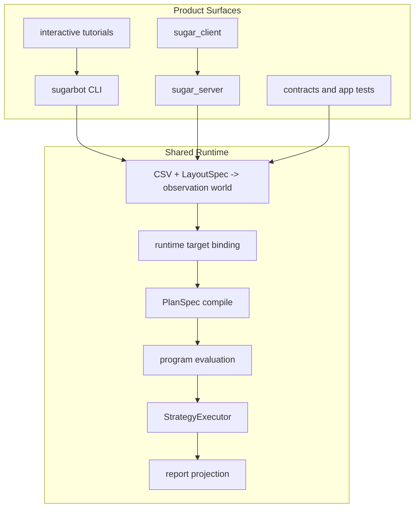

This is a healthy dependency direction. The app and service layers should remain orchestration shells. If CLI behavior or hosted behavior starts carrying unique execution semantics, the architecture will lose its strongest property: local and hosted runs can be reasoned about as the same run.

Source anchors:

- CLI entry and dispatch: [`app/entrypoints/main.cpp`](../app/entrypoints/main.cpp), [`app/commands/app_commands.cpp`](../app/commands/app_commands.cpp)
- Hosted dispatch and runtime: [`src/service/protocol_dispatch.cpp`](../src/service/protocol_dispatch.cpp), [`src/service/server_runtime.cpp`](../src/service/server_runtime.cpp)
- Shared PlanSpec runtime: [`src/sweep/plan_sweep.cpp`](../src/sweep/plan_sweep.cpp)

## Architectural Center of Gravity

The center of the system is not the executor by itself. It is the boundary between `DataView` and `PlanSpec`.

`DataView` answers what the runtime can observe. `PlanSpec` answers what the strategy wants to compute. The compiler and capability diagnostics reconcile the two.

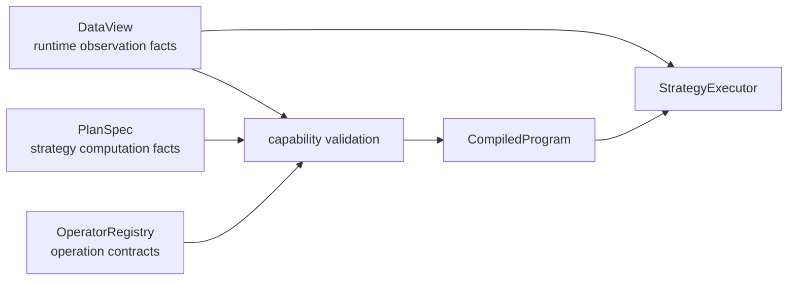

This boundary explains several implementation choices that can look strict from the outside:

- Multi-entity data requires explicit run scope because there is no universally correct primary series.
- Topology operators require query-bearing topology metadata because graph shape is runtime data, not hard-coded strategy state.
- Column refs are resolved before evaluation because the evaluator wants deterministic buffers, not late-bound string lookups.
- Dynamic execution is declared and bounded because arbitrary graph mutation would break replayability and reporting.

## Design Pattern: Contract Before Computation

The pipeline consistently favors validation before work:

1. CSV is parsed through `DataSpec`.
2. Rows become frames with explicit schema.
3. Frames are aligned into an `AlignedBundle`.
4. Runtime axes and built-in topologies are mounted.
5. Layout-declared topologies are registered.
6. A target series and primary column are bound.
7. Plan capabilities are checked against observation facts.
8. PlanSpec compiles into a row-aligned program.
9. Only then does strategy execution happen.

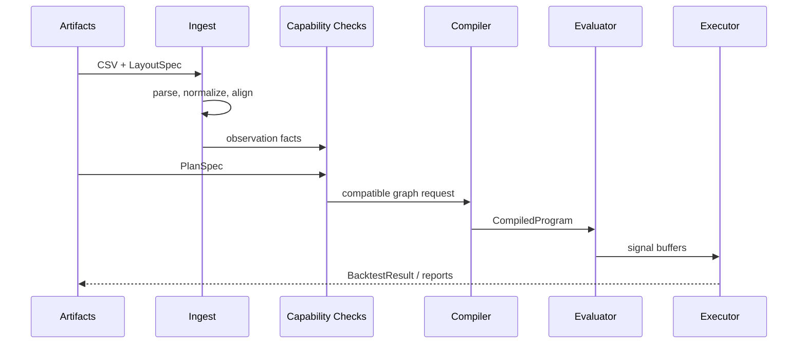

The practical implication is that many failures should remain early failures. It is better for `--obs-report` or `--plan-report` to reject a run than for the executor to produce a misleading zero-trade or NaN-heavy result.

Relevant source:

- [`src/ingest/run_pipeline.cpp`](../src/ingest/run_pipeline.cpp)
- [`src/sweep/plan_capability.cpp`](../src/sweep/plan_capability.cpp)
- [`src/sweep/plan_sweep_runtime_validation.cpp`](../src/sweep/plan_sweep_runtime_validation.cpp)

## What the Executor Does, and What It Should Not Do

The executor is intentionally narrow. It should simulate positions, not understand strategy graph structure.

It consumes:

- A `DataView`.
- A primary `ColumnRef`.
- A compiled `StrategyPlan`.
- `ExecSettings`.
- Evaluated bool buffers for entry, exit, and gate signals.

It produces:

- Trade counts.
- PnL and drawdown metrics.
- Signal counts.
- Warmup information.
- Trade behavior hash.
- Dynamic execution diagnostics already produced by evaluation.

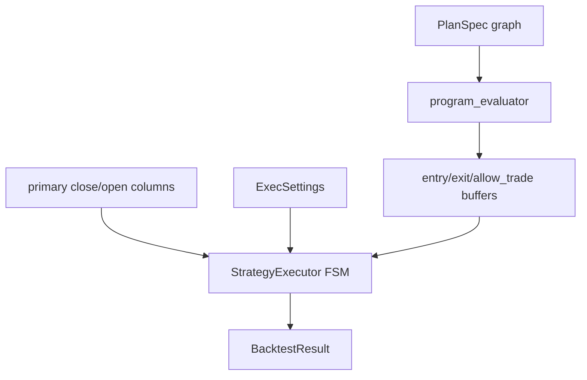

This is a good split. It keeps strategy semantics in the DAG and trading mechanics in one place. Future changes should preserve that. For example:

- Add a new indicator through the operator registry and evaluator, not the executor.
- Add a new report projection through report-layer structs, not by inflating executor state.
- Add a new execution timing policy through `ExecSettings` and the executor, not through PlanSpec node tricks.

Primary source:

- [`include/engine/strategy_executor.h`](../include/engine/strategy_executor.h)
- [`src/engine/strategy_executor.cpp`](../src/engine/strategy_executor.cpp)
- [`include/sweep/metrics.h`](../include/sweep/metrics.h)

## Why the Operator Registry Matters More Than It Looks

`OperatorRegistry` is one of the highest-leverage architecture points. It does three jobs:

1. It lists operations.
2. It gives the compiler arity, type, params, and warmup rules.
3. It gives diagnostics enough metadata to say whether an op can run on the current observation world.

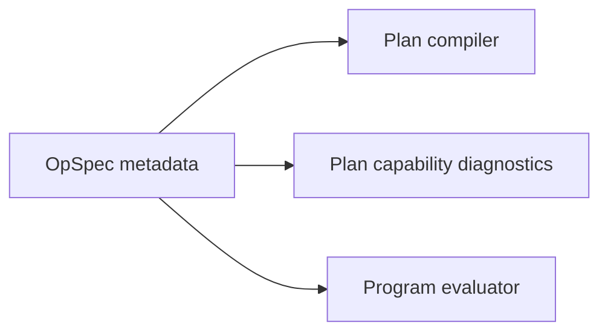

The hidden implication: registry metadata is part of runtime correctness, not just documentation. If a new op works in the evaluator but lacks accurate axis or topology metadata, the system becomes less trustworthy because preflight checks can lie.

Extension rule:

```text
new op = registry metadata + kernel/evaluator support + capability expectations + contracts
```

Relevant source:

- [`include/ops/op_registry.h`](../include/ops/op_registry.h)
- [`src/ops/op_registry.cpp`](../src/ops/op_registry.cpp)
- [`src/ops/op_module_core.cpp`](../src/ops/op_module_core.cpp)
- [`src/ops/op_module_ts.cpp`](../src/ops/op_module_ts.cpp)
- [`src/ops/op_module_topology.cpp`](../src/ops/op_module_topology.cpp)

## Topology as a Capability, Not a Feature Toggle

Topology support is not a single on/off feature. It is a family of runtime capabilities:

- Is there a time axis?
- Is there a spatial 2D axis?
- Is there an entity panel?
- Is there a query-bearing topology?
- Does the topology support neighbor sets, weighted neighbor sets, ordered windows, metric radius, hierarchy traversal, semantic similarity, or time-valid graph lookup?

This is why topology is represented through `TopologySpec`, `TopologyCatalog`, `NeighborhoodQuery`, and locality subject resolution.

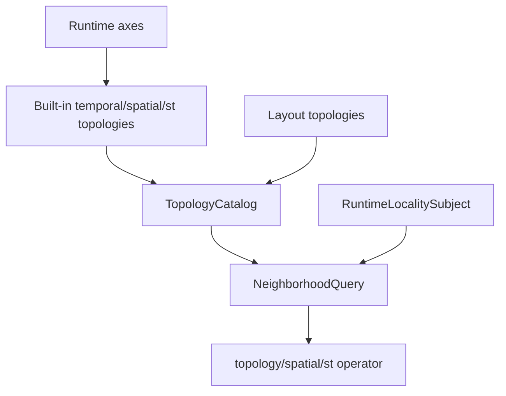

This gives SugarBot a clean route to richer graph-aware strategies, but it also raises the bar for correctness. Topology-related work should be careful about:

- Domain scope: row domain, series-local, entity-panel, or observation-domain.
- Query kind: what shape of neighborhood the op expects.
- Locality subject: whether the op is anchored to primary series, explicit series, entity, or whole observation domain.
- Provenance: whether reports can explain which topology backed a result.

Relevant source:

- [`include/ingest/topology_spec.h`](../include/ingest/topology_spec.h)
- [`include/ingest/neighborhood_query_core.h`](../include/ingest/neighborhood_query_core.h)
- [`src/ingest/data_view.cpp`](../src/ingest/data_view.cpp)
- [`src/ops/op_module_topology.cpp`](../src/ops/op_module_topology.cpp)

## Sweep Architecture: Search Policy Is Orthogonal to Strategy Semantics

Sweeps are designed as repeated PlanSpec executions with parameter overrides. The strategy graph remains the source of semantic truth. Sweep engines only decide which candidate to evaluate next and how to rank or retain results.

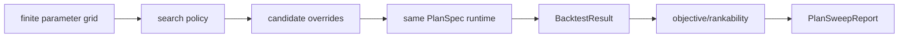

This is an important strategic choice. It means new search methods can be added without changing strategy meaning. Exhaustive grid, coarse/fine, Monte Carlo, successive halving, and Bayesian posterior are scheduling policies over a shared candidate space.

The report layer then adds:

- Objective explanation.
- Candidate outcomes and rankability.
- Diversity filtering.
- Duplicate trade path analysis.
- Search geometry.
- Pareto front summaries.
- Posterior diagnostics.
- Proposal trace and replay metadata.

The weak point to watch is report growth. `PlanSweepReport` is necessarily rich, but each new reporting feature should remain an interpretation of evaluated candidates, not a new source of execution semantics.

Relevant source:

- [`include/sweep/sweep.h`](../include/sweep/sweep.h)
- [`include/sweep/plan_sweep.h`](../include/sweep/plan_sweep.h)
- [`src/sweep/plan_sweep.cpp`](../src/sweep/plan_sweep.cpp)
- [`src/sweep/sweep_session.cpp`](../src/sweep/sweep_session.cpp)

## Panel Architecture: Same Runtime, Different Target Binding

Panel execution is not a separate multi-strategy engine. It iterates across aligned series, binds each as the primary target, runs the same PlanSpec, scores results, and keeps the top entities.

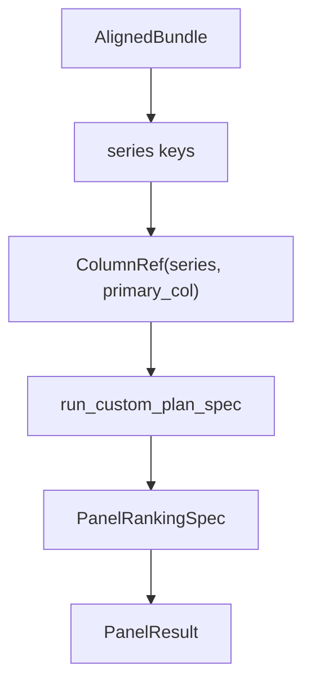

This pattern is good because it avoids creating a special panel-only strategy model. The same PlanSpec compatibility rules apply, but pre-binding observation-world diagnostics matter more because no single primary series exists yet.

Relevant source:

- [`include/sweep/panel_runner.h`](../include/sweep/panel_runner.h)
- [`src/sweep/panel_runner.cpp`](../src/sweep/panel_runner.cpp)

## Declared Dynamic Execution: Bounded Routing, Not Runtime Graph Mutation

Declared dynamic execution is best understood as row-local routing metadata over a predeclared graph. It is not an interpreter and not arbitrary graph construction.

The compiler validates:

- Subgraph declarations.
- Route conditions.
- Route cases.
- Fallback subgraphs.
- Output bindings.
- Caps such as maximum active subgraphs and decision sample limits.

The evaluator:

- Evaluates normal row-aligned buffers.
- Computes route decisions.
- Builds subgraph activity masks.
- Masks inactive node outputs.
- Gates dynamic outputs back to the strategy binding surface.
- Emits route diagnostics and digest metadata.

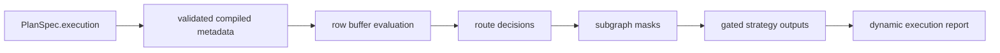

The benefit is determinism. Dynamic behavior stays replayable and bounded. The tradeoff is that this is not lazy execution in the classic sense. It is dynamic selection over a statically compiled graph model.

Relevant source:

- [`include/engine/compiled_program.h`](../include/engine/compiled_program.h)
- [`src/engine/plan_compiler.cpp`](../src/engine/plan_compiler.cpp)
- [`src/engine/program_evaluator.cpp`](../src/engine/program_evaluator.cpp)
- [`include/sweep/metrics.h`](../include/sweep/metrics.h)

## Hosted Service: Operational Controls Around the Same Core

Hosted service code adds operational safety around the runtime:

- Session creation and ownership.
- Upload staging and filename validation.
- Artifact sandboxing.
- Request validation.
- Quotas.
- Fair job scheduling.
- Worker pool execution.
- Cancellation.
- Result retention.
- Protocol framing and JSON request/response serialization.
- Security and abuse logging.

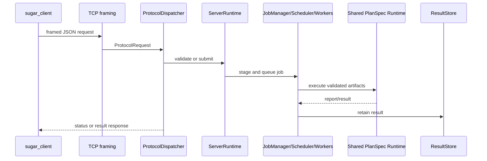

The main architectural strength is that hosted behavior does not redefine what a run means. It governs whether and how a job is accepted, scheduled, canceled, and retained. Execution still funnels back through `run_custom_plan_spec` or panel execution.

Relevant source:

- [`src/service/protocol_framing.h`](../src/service/protocol_framing.h)
- [`src/service/protocol_dispatch.cpp`](../src/service/protocol_dispatch.cpp)
- [`src/service/server_runtime.cpp`](../src/service/server_runtime.cpp)
- [`src/service/job_scheduler.h`](../src/service/job_scheduler.h)
- [`src/service/job_worker_pool.h`](../src/service/job_worker_pool.h)
- [`src/service/artifact_store.h`](../src/service/artifact_store.h)
- [`src/service/result_store.h`](../src/service/result_store.h)

## Reporting Is Interpretation, Not Execution

SugarBot has a clear split between raw execution and interpreted reporting.

Raw execution output:

- `BacktestResult`

Interpretation/reporting output:

- `RunReport`
- `PlanSweepReport`
- `PanelReport`
- `EvaluationReport`
- JSON projections
- Focused projections such as objective, topology, geometry, Pareto, posterior, and trace

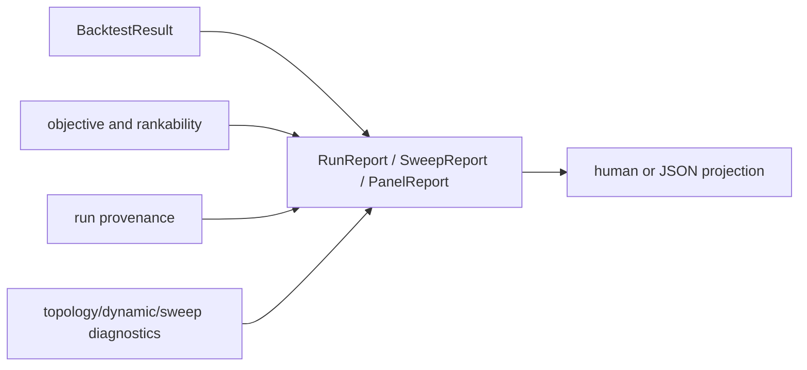

This distinction is worth preserving. `BacktestResult` should remain close to execution. Reports can grow to explain what happened, why candidates ranked the way they did, and what provenance backed the run.

Relevant source:

- [`include/sweep/metrics.h`](../include/sweep/metrics.h)
- [`include/sweep/evaluation_report.h`](../include/sweep/evaluation_report.h)
- [`src/sweep/evaluation_report.cpp`](../src/sweep/evaluation_report.cpp)
- [`src/sweep/evaluation_report_json.cpp`](../src/sweep/evaluation_report_json.cpp)
- [`src/sweep/evaluation_report_text.cpp`](../src/sweep/evaluation_report_text.cpp)

## Hidden Implications for Future Work

### The project is schema-sensitive

`DataSpec`, `LayoutSpec`, `PlanSpec`, `TopologySpec`, protocol JSON, and evaluation-report JSON are all schema-like surfaces. Even when they are implemented by C++ structs and a small JSON parser, they behave like public contracts. Backward-compatible evolution matters.

### The system prefers visible failure to silent fallback

This is why many flows have obs-report, plan-report, capability reports, and precise rejection paths. Future convenience features should preserve visibility. A fallback is acceptable when it is reported; a hidden coercion weakens the architecture.

### `PlanSpec` is nearing overload

`PlanSpec` carries graph structure, params, bindings, execution settings, sweep configuration, run dispatch, dynamic execution metadata, and objective/ranking information. That is coherent today because all fields describe the requested run. But future additions should be challenged:

- Is this strategy semantics?
- Is this data binding?
- Is this search policy?
- Is this report-only preference?
- Is this hosted-service policy?

Putting every new control into `PlanSpec` would eventually make it harder to reason about what changes execution and what changes presentation.

### The app layer is already a diagnostics product

The CLI does more than run. It scaffolds, dumps layout and plan schemas, prints op catalogs, emits obs reports, plan reports, feature dumps, alignment dumps, report projections, and tutorial flows. That is valuable, but it means app output has user-facing stability concerns even when core runtime is unchanged.

### Contracts are part of the architecture, not just tests

The contract suite encodes architecture promises: service isolation, runtime design loads, overload rejection, topology readiness, dynamic execution determinism, numeric portability, and assertion hygiene. These tests are effectively executable architecture documentation.

Relevant source:

- [`src/contracts/contract_suite.cpp`](../src/contracts/contract_suite.cpp)
- [`app/tests/app_tests.cpp`](../app/tests/app_tests.cpp)
- [`CMakeLists.txt`](../CMakeLists.txt)

## Weak Areas to Watch

### Report schema sprawl

Reports are intentionally rich. The risk is not richness itself; it is mixing execution facts, derived interpretation, UI projection preferences, and hosted-service status into the wrong structures. Keep `BacktestResult` small and use report-layer structs for interpretation.

### Dynamic execution expectations

The phrase "dynamic execution" can imply fully lazy graph evaluation or runtime graph construction. The implementation is better described as declared, bounded row-local routing over a compiled graph. Documentation and UI wording should keep that distinction clear.

### PlanSpec mental load

The PlanSpec model is powerful, but users and contributors need layered explanations. A good pattern is:

1. Graph nodes and bindings.
2. Runtime target and run scope.
3. Sweep/search policy.
4. Dynamic execution.
5. Advanced reporting.

Trying to explain all of it at once makes the model feel larger than it is.

### Hosted service threat model

The hosted service has good defensive controls, but there is no sign in the active code that it is an authenticated or encrypted public service. The remote-bind policy and service profiles are important. Public exposure should remain a separate deployment/security decision, not a CLI convenience flag.

## Practical Stewardship Rules

Use these rules when changing the codebase:

1. Add data-domain concepts in ingest/runtime first.
   - Good fit: `DataSpec`, `LayoutSpec`, `IndexSchema`, `AlignedBundle`, `DataView`, capability diagnostics.

2. Add computation concepts through operators.
   - Good fit: `OperatorRegistry`, op modules, kernels, evaluator support, operator-axis contracts.

3. Keep executor changes about execution mechanics.
   - Good fit: timing, fill, costs, reversal rules, trade lifecycle, cancellation checks.

4. Keep search methods independent from strategy semantics.
   - Good fit: sweep policy over candidate indices, objective scoring, collector/report behavior.

5. Keep hosted policy out of core execution.
   - Good fit: quotas, upload rules, sessions, scheduling, cancellation, result retention.

6. Keep report interpretation out of raw execution state.
   - Good fit: `RunReport`, `PlanSweepReport`, `PanelReport`, `EvaluationReport`.

## Strategic Summary

SugarBot has a coherent architecture because almost every capability routes through the same two contracts:

```text
Observation contract: what data exists, how it is aligned, and what topology/locality capabilities it exposes.
Strategy contract: what graph should be computed, how outputs bind to execution, and what search/report semantics apply.
```

The strongest future direction is to keep making these contracts more explicit, not more magical. The project can absorb new operators, new topology providers, new sweep policies, richer reports, and safer hosted workflows as long as each lands in the right layer and preserves deterministic replayability.

The architecture is broad, but it is not shapeless. Its organizing principle is stable: validate the world, compile the graph, execute deterministic buffers, and report enough provenance for the result to be trusted.
