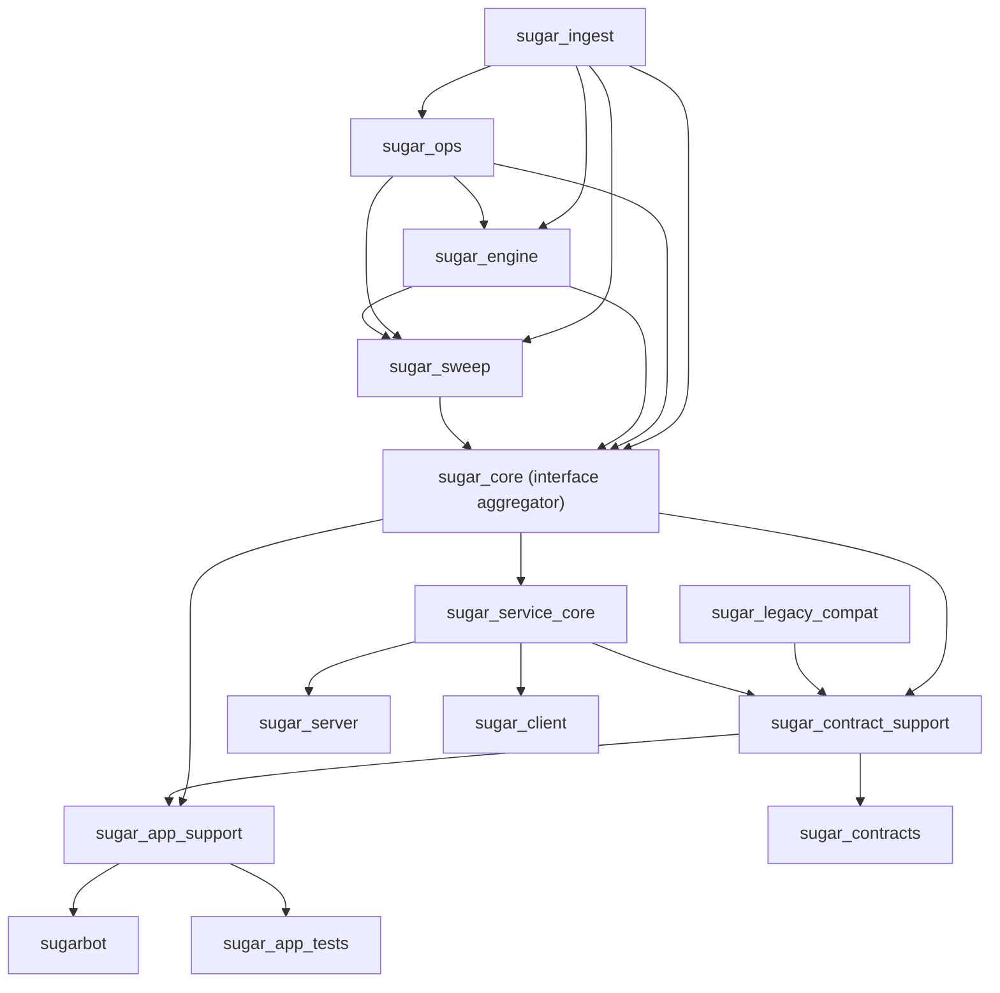
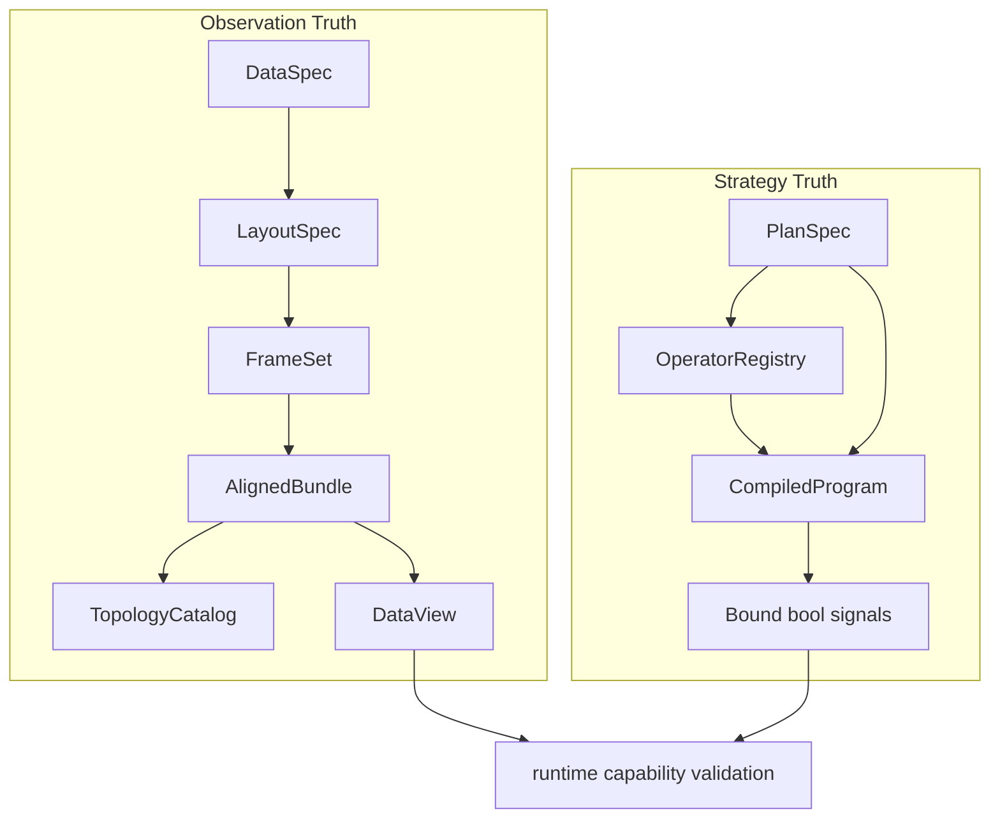
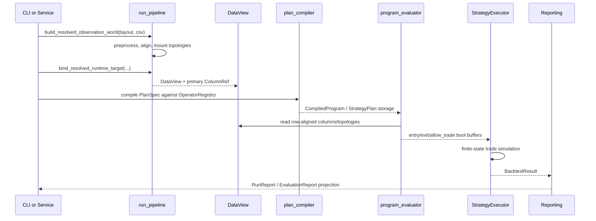
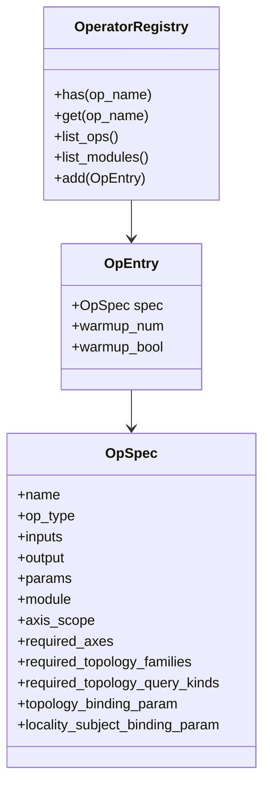
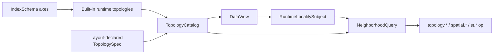
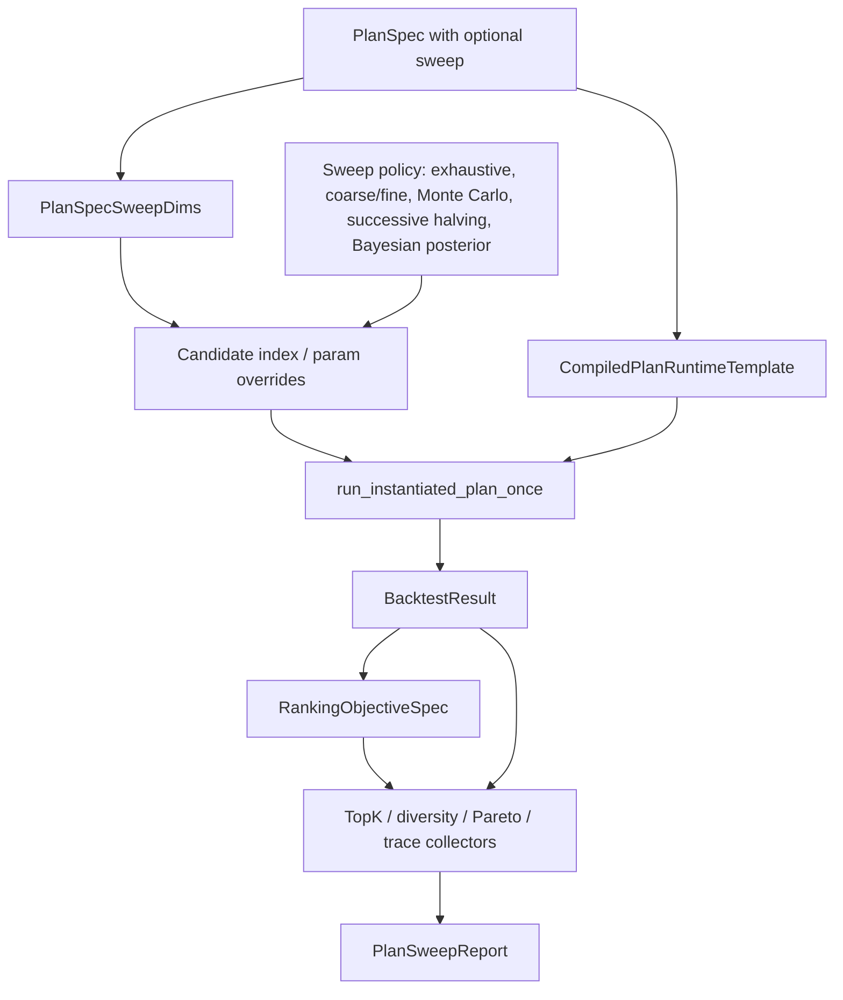
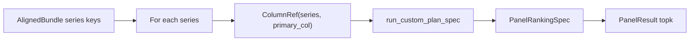
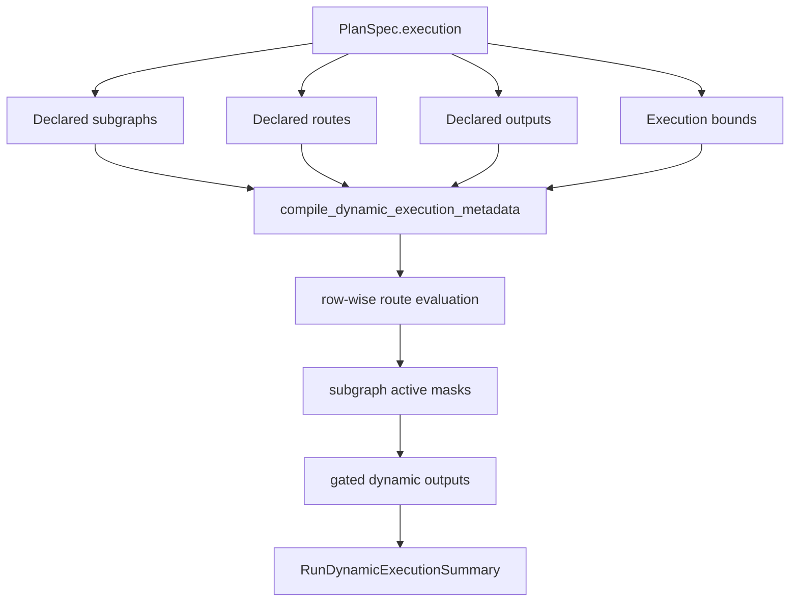
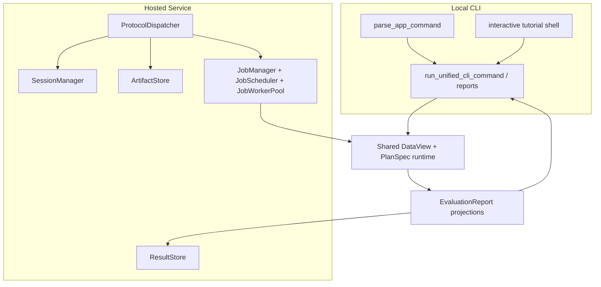
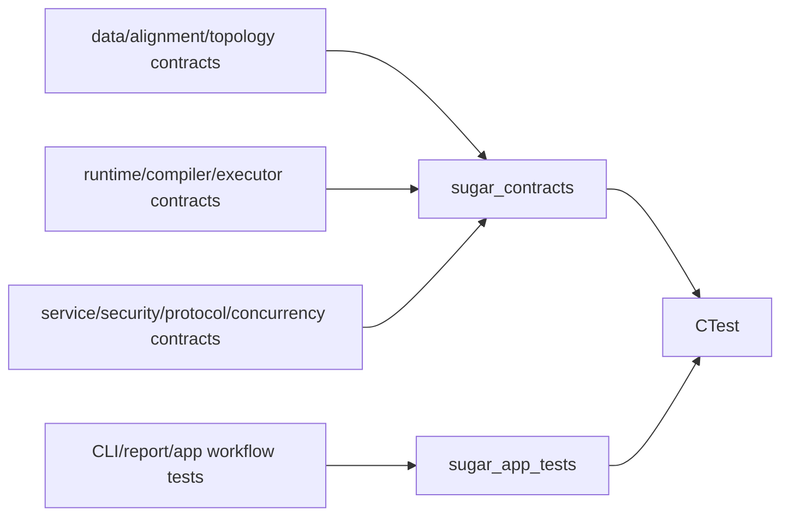

# SugarBot Architecture Insight Summary

This note summarizes the implemented architecture in the C++ and header files, not the README surface. It is intended as a compact executive map with enough implementation detail to help future changes land in the right layer.

## Architecture Thesis

SugarBot is a contract-first execution platform. The central design is not "run a trading bot"; it is:

1. Accept explicit artifacts.
2. Prove they describe a valid observation world and valid logic graph.
3. Compile the graph into deterministic row-aligned runtime buffers.
4. Execute bound signals through one finite-state strategy executor.
5. Project the result through local CLI, panel/sweep reports, or hosted service results.

The canonical runtime chain is:

:::mermaid
flowchart LR
    CSV["CSV artifact"]
    Layout["LayoutSpec / DataSpec"]
    World["ResolvedObservationWorld"]
    Runtime["ResolvedRuntimeInput"]
    View["DataView + ColumnRef"]
    Plan["PlanSpec DAG"]
    Program["CompiledProgram"]
    Buffers["Numeric/Bool row buffers"]
    Executor["StrategyExecutor"]
    Result["BacktestResult"]
    Report["Run/Sweep/Panel/EvaluationReport"]

    CSV --> Layout
    Layout --> World
    World --> Runtime
    Runtime --> View
    Plan --> Program
    View --> Buffers
    Program --> Buffers
    Buffers --> Executor
    Executor --> Result
    Result --> Report
:::

Relevant source landmarks:

- Ingest/runtime world construction: [`src/ingest/run_pipeline.cpp`](../src/ingest/run_pipeline.cpp)
- Runtime data facade: [`include/ingest/data_view.h`](../include/ingest/data_view.h)
- Plan schema: [`include/sweep/plan_spec.h`](../include/sweep/plan_spec.h)
- Compiler: [`src/engine/plan_compiler.cpp`](../src/engine/plan_compiler.cpp)
- Evaluator: [`src/engine/program_evaluator.cpp`](../src/engine/program_evaluator.cpp)
- Executor: [`src/engine/strategy_executor.cpp`](../src/engine/strategy_executor.cpp)
- Reports and metrics: [`include/sweep/metrics.h`](../include/sweep/metrics.h), [`include/sweep/evaluation_report.h`](../include/sweep/evaluation_report.h)

## Build-Time Shape

The CMake graph makes the intended ownership boundaries visible. Core runtime libraries are lower-level than app and service surfaces, and both app and service eventually route back into the same execution primitives.

Primary definitions live in [`CMakeLists.txt`](../CMakeLists.txt). The important architectural implication is that `sugarbot`, `sugar_server`, and tests are surfaces, not independent runtimes.

## The Key Separation: Observation Truth vs Strategy Truth

SugarBot deliberately separates two kinds of truth.

Observation truth is represented by `DataSpec`, `LayoutSpec`, `FrameSet`, `AlignedBundle`, `TopologyCatalog`, `ResolvedObservationWorld`, and `DataView`. This side answers:

- What columns exist?
- What time/entity/spatial axes exist?
- How are multiple series aligned?
- What topology providers are available?
- Which primary series and column are bound for this run?

Strategy truth is represented by `PlanSpec`, `OperatorRegistry`, `CompiledProgram`, signal bindings, sweep config, and optional declared dynamic execution. This side answers:

- What numeric and bool nodes are computed?
- Which ops and params are legal?
- Which bool nodes become `entry_long`, `exit_long`, `entry_short`, `exit_short`, and `allow_trade`?
- Which parameter space, objective, or route metadata applies?

This separation explains the emphasis on preflight diagnostics. The system is built to reject ambiguity before execution, especially for multi-entity data, topology usage, and primary target binding.

## Runtime Execution Pipeline

At runtime, `PlanSpec` is compiled once into a template/program shape, instantiated with params or sweep overrides, evaluated against a `DataView`, then executed by a finite-state strategy executor.

The executor is intentionally narrow. It does not know the DAG. It consumes final signal buffers and applies trading mechanics such as long/short mode, same-bar or next-bar timing, fill timing, costs, reversal behavior, warmup, and close-out-at-end. See [`include/engine/strategy_executor.h`](../include/engine/strategy_executor.h) and [`src/engine/strategy_executor.cpp`](../src/engine/strategy_executor.cpp).

## Operator Registry Pattern

`OperatorRegistry` is more than a name-to-function lookup. Each op carries:

- Numeric or bool type.
- Input and output value types.
- Module name.
- Param schema and defaults.
- Warmup semantics.
- Axis scope.
- Required axes.
- Required topology families and query kinds.
- Optional topology and locality subject binding params.

That metadata is the reason SugarBot can diagnose PlanSpec/data compatibility before execution. Extension work should therefore enter through registry metadata plus evaluator/kernel support, not through app-level special cases.

## Topology and Locality Are Runtime Capabilities

Topologies are mounted into the observation world, not hard-coded into strategies. Built-in time, spatial, and spatiotemporal providers are mounted from aligned runtime axes; layout-declared graph, hierarchy, semantic, or time-valid topology specs are mounted into a catalog and resolved through `DataView`.

The important nuance: topology support is a capability contract. A PlanSpec node can require a topology family or query kind, but execution only proceeds if the resolved runtime can supply it. This is enforced through registry metadata, capability diagnostics, and `DataView::resolve_topology`.

Relevant files:

- [`include/ingest/topology_spec.h`](../include/ingest/topology_spec.h)
- [`include/ingest/neighborhood_query_core.h`](../include/ingest/neighborhood_query_core.h)
- [`src/ingest/data_view.cpp`](../src/ingest/data_view.cpp)
- [`src/ops/op_module_topology.cpp`](../src/ops/op_module_topology.cpp)

## Sweep and Panel Orchestration

Sweeps are repeated PlanSpec instantiations, not separate strategy implementations. The sweep layer owns candidate generation, scoring, diversity, Pareto, trace, posterior diagnostics, and report assembly. The graph semantics remain the same.

Panel mode uses the same PlanSpec runtime but iterates over aligned series/entities, binding each series as the primary and ranking successful runs.

Relevant files:

- [`include/sweep/plan_sweep.h`](../include/sweep/plan_sweep.h)
- [`src/sweep/plan_sweep.cpp`](../src/sweep/plan_sweep.cpp)
- [`include/sweep/panel_runner.h`](../include/sweep/panel_runner.h)
- [`src/sweep/panel_runner.cpp`](../src/sweep/panel_runner.cpp)

## Declared Dynamic Execution

Dynamic execution is bounded PlanSpec routing metadata, not arbitrary graph mutation. The compiler validates declared subgraphs, routes, route cases, fallbacks, outputs, and bounds. The evaluator still works in the row-buffer model, then applies route/subgraph masks and emits dynamic diagnostics.

This gives dynamic behavior while preserving replayability, bounded report size, and deterministic evaluation.

## CLI and Hosted Service Are Adapters

The app layer parses commands, builds/validates the observation world, dispatches run scope, and prints projections. It does not own core semantics. Hosted service follows the same rule: it stages uploaded artifacts, validates shape and compatibility, queues jobs, and calls the same PlanSpec runtime.

Hosted mode adds operational controls around the same execution path: session ownership, upload validation, quotas, expensive sweep rejection, cancellation propagation, retained results, and TCP framing.

Relevant files:

- CLI entry: [`app/entrypoints/main.cpp`](../app/entrypoints/main.cpp)
- CLI commands: [`app/commands/app_commands.cpp`](../app/commands/app_commands.cpp)
- App runtime helpers: [`app/runtime/app_runtime.cpp`](../app/runtime/app_runtime.cpp)
- Protocol model: [`src/service/protocol_framing.h`](../src/service/protocol_framing.h)
- Dispatcher: [`src/service/protocol_dispatch.cpp`](../src/service/protocol_dispatch.cpp)
- Server runtime: [`src/service/server_runtime.cpp`](../src/service/server_runtime.cpp)
- TCP server: [`src/service/network_server.cpp`](../src/service/network_server.cpp)

## Contract and Test Culture

The test architecture mirrors the production architecture. There is a deterministic contract-suite executable and an app-suite executable. Contract sections cover data contracts, alignment, topology, capabilities, compile bridge, dynamic execution, service protocol, security abuse, concurrency, numeric portability, and runtime hygiene.

Relevant files:

- Contract runner: [`src/contracts/contract_suite.cpp`](../src/contracts/contract_suite.cpp)
- App test runner: [`app/tests/app_tests.cpp`](../app/tests/app_tests.cpp)
- CTest registration: [`CMakeLists.txt`](../CMakeLists.txt)
- Presets: [`CMakePresets.json`](../CMakePresets.json)

## Hidden Implications

### The system optimizes for auditability over convenience

Many apparent "strict" behaviors are architectural choices: explicit layout fields, explicit multi-entity run scope, explicit topology binding, and explicit primary target resolution. These reduce silent coercion. The cost is more authoring ceremony; the benefit is that a failed run can usually say which artifact boundary failed.

### DataView is the real runtime boundary

Legacy candle/series types still exist, but the active architecture centers on `DataView + ColumnRef`. This is what allows the same executor to handle single-series data, panels, spatial axes, topology-local ops, and hosted artifact runs. Future runtime features should probably preserve that boundary instead of reintroducing strategy-specific input shapes.

### PlanSpec is powerful but broad

`PlanSpec` now carries graph structure, parameters, trade execution settings, run dispatch hints, sweep configuration, ranking objectives, Pareto/diversity/posterior settings, and declared dynamic execution metadata. That is coherent because all of it describes "what should this run mean?", but it creates schema pressure. Future changes should be careful about whether a new field belongs in:

- Plan semantics.
- Runtime binding.
- Sweep/search policy.
- Report projection.
- Hosted-service policy.

### Dynamic execution is deterministic routing, not an interpreter

Declared dynamic execution preserves the row-buffer execution model. It masks and gates outputs according to validated route metadata. That keeps replay and report diagnostics tractable, but it means dynamic execution should not be treated as arbitrary runtime graph construction.

### Reports are becoming a public product surface

`BacktestResult` is execution output; `RunReport`, `PlanSweepReport`, `PanelReport`, and `EvaluationReport` are interpretation surfaces. Keeping provenance, objective/rankability, topology diagnostics, diversity, Pareto, and JSON projections in report-layer structures is important. Pushing those concerns back into the executor would blur responsibilities.

### Hosted mode is an operational shell around local semantics

The hosted service is valuable because it does not redefine execution. It adds sessions, upload staging, quotas, worker scheduling, cancellation, result ownership, and framed protocol behavior around the same validated runtime. That makes local and hosted behavior easier to compare, test, and trust.

## Practical Extension Guidance

When adding a new observation capability, start in ingest/runtime contracts: `DataSpec`, `LayoutSpec`, `IndexSchema`, `AlignedBundle`, `DataView`, and capability diagnostics.

When adding a new operator, update the registry metadata and evaluator/kernel support together. The metadata should describe axis and topology requirements as explicitly as the evaluator enforces them.

When adding a new sweep/search method, keep it as a policy over candidate indices or parameter overrides. Avoid embedding strategy semantics into the sweep engine.

When adding hosted behavior, keep it in service policy unless it changes local execution semantics. Hosted limits, upload rules, session behavior, and abuse handling should not leak into `BacktestResult` or the executor.

When adding report output, prefer report-layer structs and projections. Avoid using executor metrics as a dumping ground for interpretation, provenance, or UI concerns.

## Short Version

SugarBot is a deterministic, artifact-driven strategy runtime with strong validation and diagnostics. Its deepest architectural pattern is that advanced features - panels, topology, declared dynamic routing, sweeps, hosted jobs, and report projections - all route back through the same explicit observation-world and PlanSpec execution contract. That gives the codebase coherence despite its breadth.
