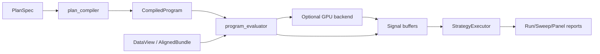
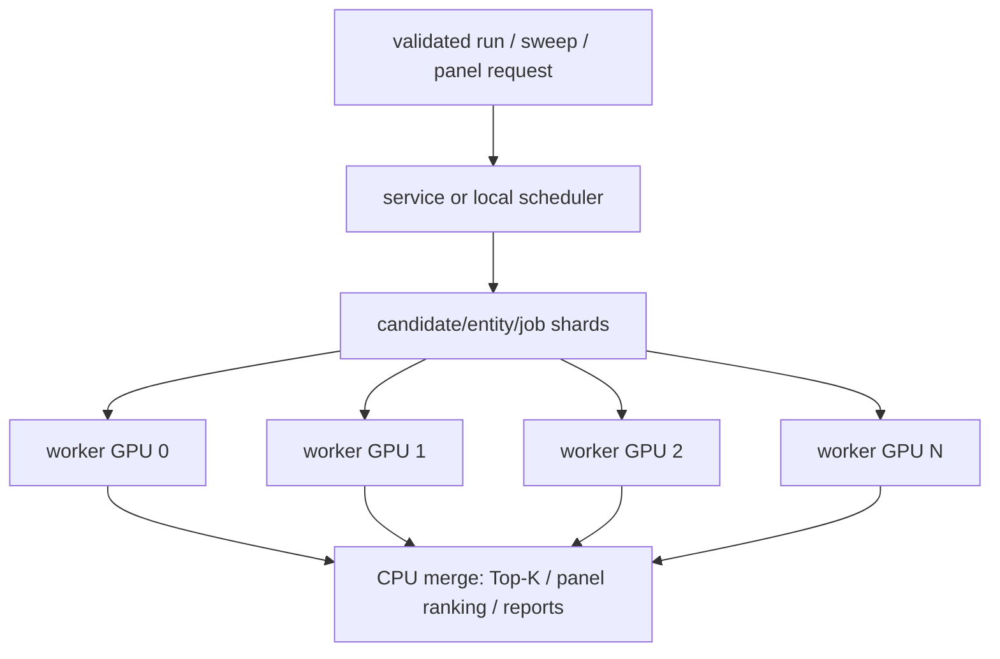
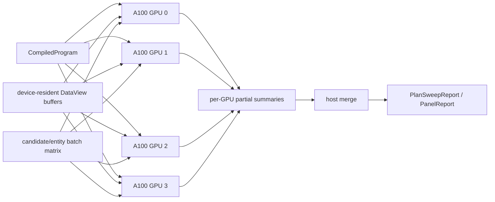
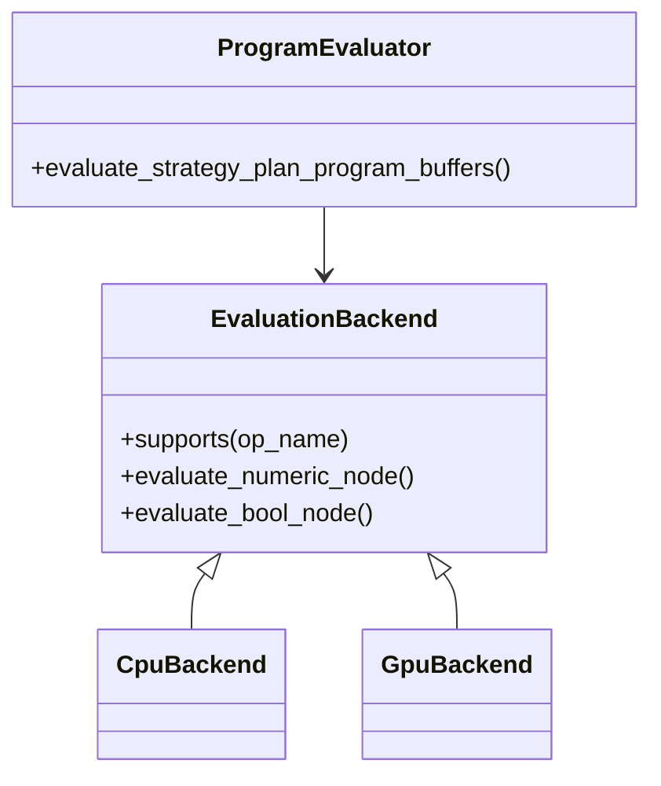
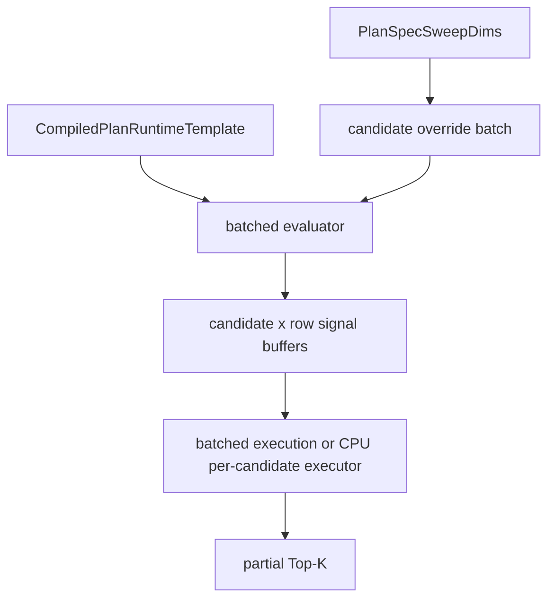

# SugarBot GPU Support Roadmap

This roadmap sits alongside [`architecture_insight_summary.md`](architecture_insight_summary.md) and [`architecture_executive_deep_dive.md`](architecture_executive_deep_dive.md). It outlines where GPU support fits SugarBot's current architecture, ordered from lowest engineering effort to highest, and explains how priorities change across one consumer RTX 3060, six non-parallelized RTX 3060s, and four fully parallelized A100s.

## Executive Summary

GPU support should enter SugarBot through the row-aligned runtime, not through the CLI or hosted protocol. The best acceleration targets are:

1. Numeric/vector kernels in program evaluation.
2. Batched sweep candidate evaluation.
3. Panel/entity-parallel execution.
4. Large topology/neighborhood workloads.
5. Bayesian posterior/acquisition internals.
6. Full device-resident compiled-program execution.

The first GPU layer should be optional, deterministic, single-device, batch-aware, and CPU-fallback. Multi-GPU support should start as scheduler-level sharding before attempting a fully coordinated multi-device execution backend.

## Where GPU Fits The Current Architecture

SugarBot already has a useful shape for GPU acceleration: `CompiledProgram` evaluates row-aligned numeric and bool buffers over a `DataView`, then `StrategyExecutor` consumes final bool signal buffers. That suggests GPU should initially accelerate evaluator-side buffer production and later batched candidate/entity execution.



Good first integration points:

- [`src/engine/program_evaluator.cpp`](../src/engine/program_evaluator.cpp)
- [`include/engine/compiled_program.h`](../include/engine/compiled_program.h)
- [`src/ops/op_kernels_ts.cpp`](../src/ops/op_kernels_ts.cpp)
- [`src/ops/op_kernels_math.cpp`](../src/ops/op_kernels_math.cpp)
- [`src/ops/op_kernels_spatial.cpp`](../src/ops/op_kernels_spatial.cpp)
- [`src/ops/op_kernels_topology.cpp`](../src/ops/op_kernels_topology.cpp)

Areas that should not be first targets:

- CSV parsing and JSON parsing.
- CLI command parsing and tutorial flows.
- Hosted protocol framing.
- Text/JSON report rendering.
- The branch-heavy trade lifecycle inside `StrategyExecutor`, unless batched execution later proves it worthwhile.

## Workload Fit

| Workload | GPU Fit | Why |
|---|---:|---|
| Row-wise arithmetic ops | High | Embarrassingly parallel vectors. |
| Rolling/window time-series ops | Medium-High | Good for long rows, but requires careful prefix/window algorithms. |
| Sweep candidates | Very High | Many independent evaluations over shared data. |
| Panel entities | Very High | Same graph over many aligned series. |
| Spatial radius/KNN | Medium-High | Good at scale; needs GPU-friendly layouts. |
| Static graph neighborhood aggregation | Medium | Irregular memory access; depends on graph size. |
| Semantic embeddings | High | Similarity/KNN can map well to GPU. |
| Bayesian posterior/acquisition | Medium-High | Useful once candidate feature matrices are large. |
| Single small backtest | Low | Kernel launch and transfer overhead can dominate. |
| Hosted session/protocol handling | Low | Control-plane workload. |

## Hardware Profiles

### 1x Consumer RTX 3060

The RTX 3060 case rewards careful thresholds. Single small runs may be slower on GPU because PCIe transfer and launch overhead can dominate. The GPU becomes useful when row counts, entity counts, or candidate batches are large enough.

Best strategy:

- Optional single-device CUDA backend.
- CPU canonical path remains default.
- Runtime thresholding decides whether a node/batch runs on GPU.
- Prioritize batched sweeps and large row-aligned numeric kernels.

Avoid:

- Tiny per-node GPU offloads.
- Device transfers for every node.
- Complex multi-GPU abstractions.

### 6x RTX 3060, Not Parallelized

If the code is not multi-GPU aware, six RTX 3060s do not automatically accelerate one job. They can, however, improve throughput by running independent jobs, sweep shards, or panel partitions concurrently.

Best strategy:

- Assign one worker/process to one GPU.
- Shard sweeps by candidate index ranges.
- Shard panels by entity ranges.
- Merge Top-K, Pareto, diversity, and report summaries on CPU.

This is the lowest-risk multi-GPU path because it avoids shared device memory and cross-GPU synchronization.



### 4x A100, Fully Parallelized

A100-class hardware justifies deeper work. The goal shifts from opportunistic kernel acceleration to high-throughput, device-resident batched execution.

Best strategy:

- Keep aligned data resident on device.
- Evaluate batches of candidates/entities as matrices.
- Partition candidate/entity space across GPUs.
- Compute partial Top-K/Pareto/diversity summaries per GPU.
- Merge compact summaries on host.
- Consider GPU acceleration for topology and Bayesian posterior internals.

Avoid:

- CPU orchestration bottlenecks.
- Frequent host-device transfers.
- Per-candidate CPU compile/evaluate loops.



## Roadmap By Engineering Effort

### Phase 0: Measurement And Guardrails

Goal: identify real bottlenecks before adding GPU code.

Work items:

- Add timing/profiling around `program_evaluator`, sweep candidate evaluation, panel loops, and topology ops.
- Capture row count, series count, node count, candidate count, and elapsed time in debug or optional diagnostics.
- Add deterministic benchmark fixtures for representative workloads:
  - Single long time-series run.
  - Large exhaustive sweep.
  - Multi-entity panel run.
  - Spatial/topology-heavy run.
  - Bayesian posterior sweep.

Exit criteria:

- A CPU baseline exists for target workloads.
- Thresholds for "GPU likely helps" are data-informed.

### Phase 1: Optional GPU Backend Interface

Goal: create a CPU-fallback backend boundary without changing semantics.

Work items:

- Define a small evaluator backend interface for selected numeric/bool buffer ops.
- Keep CPU as the reference backend.
- Add runtime backend selection: CPU, auto, GPU if available.
- Add parity tests that compare CPU and GPU outputs with defined numeric tolerances.
- Keep `BacktestResult` and report schemas unchanged.

Suggested boundary:



Exit criteria:

- GPU can be disabled completely.
- CPU output remains canonical.
- Unsupported ops transparently fall back to CPU.

### Phase 2: Row-Wise And Simple Vector Kernels

Goal: accelerate the safest, most parallel evaluator work.

Good candidates:

- `ts.add`, `ts.sub`, `ts.mul`, `ts.div`
- `ts.min`, `ts.max`
- `ts.neg`, `ts.abs`, `ts.log`, `ts.exp`, `ts.sqrt`
- `ts.clamp`, `ts.clamp_const`
- `core.const`, `core.select`
- comparison ops such as `cmp.gt`, `cmp.lt`, `cmp.cross_up`, `cmp.cross_down`

Work items:

- Use device buffers for selected numeric and bool vectors.
- Avoid copying buffers back after every node when the next supported node can stay on GPU.
- Add auto thresholds based on row count and estimated operation cost.

Exit criteria:

- Large row-wise graphs improve on one RTX 3060.
- Small graphs remain on CPU or do not regress materially.

### Phase 3: Rolling And Window Kernels

Goal: accelerate high-cost temporal operators.

Good candidates:

- SMA/EMA where appropriate.
- Rolling min/max.
- Rolling stddev/zscore.
- Normalize minmax.
- Donchian upper/lower/mid/width.
- RSI/ATR variants after simpler window kernels stabilize.

Challenges:

- Warmup semantics must match CPU exactly.
- NaN/missing behavior must stay compatible.
- Some rolling algorithms need prefix sums, segmented scans, or deque-like algorithms.

Exit criteria:

- Long single-series workloads show meaningful speedup.
- CPU/GPU warmup and NaN behavior match contract tests.

### Phase 4: Batched Sweep Candidate Evaluation

Goal: exploit the biggest parallelism source: many independent candidate runs.

Current architecture evaluates sweep candidates through `run_custom_plan_spec` with parameter overrides. The GPU path should batch candidate overrides and evaluate compatible nodes across many candidate lanes.



Two implementation options:

1. GPU evaluates graph buffers, CPU runs `StrategyExecutor` per candidate.
2. GPU evaluates graph buffers and also runs a batched executor kernel.

Start with option 1. It is easier and still useful when graph evaluation dominates. Option 2 is more complex but better for A100-scale sweeps.

Exit criteria:

- Exhaustive and Monte Carlo sweeps can process candidate batches.
- Top-K and report semantics are unchanged.
- Cancellation and progress reporting still work at batch granularity.

### Phase 5: Panel Entity Parallelism

Goal: accelerate multi-entity runs by treating series lanes as a batch dimension.

Work items:

- Build entity batches from `AlignedBundle.series_keys`.
- Evaluate the same PlanSpec across multiple primary series lanes.
- Keep per-entity failures and missing-column handling visible.
- Merge rankings on CPU.

This is especially valuable for many aligned entities because graph structure and params are shared.

Exit criteria:

- Panel runs speed up with large entity counts.
- Result ordering and tie-break behavior match CPU.

### Phase 6: Scheduler-Level Multi-GPU Sharding

Goal: use multiple GPUs without a fully coordinated multi-device runtime.

Best for:

- 6x RTX 3060 hosts.
- Hosted service throughput.
- Large sweeps and panels.

Work items:

- Add GPU resource inventory/configuration.
- Add worker affinity: one worker uses one GPU id.
- Add sweep shard partitioning by candidate index.
- Add panel shard partitioning by entity range.
- Merge partial reports on host.
- Preserve service quotas and cancellation.

Source areas:

- [`src/service/job_scheduler.h`](../src/service/job_scheduler.h)
- [`src/service/job_worker_pool.h`](../src/service/job_worker_pool.h)
- [`src/service/server_runtime.cpp`](../src/service/server_runtime.cpp)
- [`src/sweep/plan_sweep.cpp`](../src/sweep/plan_sweep.cpp)
- [`src/sweep/panel_runner.cpp`](../src/sweep/panel_runner.cpp)

Exit criteria:

- A 6x RTX 3060 host can run six independent GPU workers.
- A sweep can be split into shards and merged deterministically.

### Phase 7: Topology, Spatial, And Semantic GPU Kernels

Goal: accelerate irregular but high-value locality workloads.

Good candidates:

- Spatial radius queries.
- Spatial KNN.
- Semantic embedding similarity and KNN.
- Large static graph neighbor aggregation.
- Weighted neighbor sums.

Data structure work:

- GPU-friendly adjacency arrays, likely CSR/COO for graphs.
- Dense embedding matrices for semantic search.
- Coordinate arrays for spatial queries.
- Explicit topology transfer/cache lifetime.

Exit criteria:

- Large topology workloads speed up without weakening query-kind and locality-subject validation.
- Topology provenance remains reportable.

### Phase 8: Bayesian Posterior And Acquisition Acceleration

Goal: accelerate posterior sweep policy internals when candidate spaces are large.

Targets:

- Candidate feature matrix generation.
- Acquisition scoring over large grids.
- Gaussian-process or surrogate math if it becomes a bottleneck.

Exit criteria:

- Bayesian posterior sweeps show speedup on large grids.
- Proposal trace and replay metadata remain deterministic.

### Phase 9: End-To-End Device-Resident Execution

Goal: fully exploit A100-class hardware.

This is the highest-effort option. It means `CompiledProgram` becomes executable as a device graph over device-resident data, candidate/entity batches stay on GPU, and only compact summaries return to the host.

Work items:

- Device memory ownership model for `AlignedBundle` data.
- Device representation of `CompiledProgram`.
- Kernel fusion or graph scheduling strategy.
- Batched signal evaluation.
- Batched trade-state execution.
- Per-GPU partial ranking, Pareto, diversity, trace summaries.
- Host-side merge and report finalization.
- Multi-GPU cancellation and progress semantics.

Exit criteria:

- 4x A100 can reduce latency for large sweeps/panels, not just improve throughput.
- Host-device transfer is amortized or minimized.
- Reports remain compatible with CPU path.

## Hardware-Specific Priority Matrix

| Phase | 1x RTX 3060 | 6x RTX 3060 non-parallel | 4x A100 fully parallel |
|---|---:|---:|---:|
| Phase 0: measurement | Critical | Critical | Critical |
| Phase 1: backend interface | Critical | Critical | Critical |
| Phase 2: row-wise kernels | High | Medium | High |
| Phase 3: rolling kernels | High | Medium | High |
| Phase 4: batched sweeps | High | High | Critical |
| Phase 5: panel batching | Medium-High | High | Critical |
| Phase 6: scheduler multi-GPU sharding | Low | Critical | Medium |
| Phase 7: topology/semantic kernels | Medium | Medium | High |
| Phase 8: posterior acceleration | Medium | Medium | High |
| Phase 9: end-to-end GPU runtime | Low | Low-Medium | High-Critical |

## Determinism And Testing Requirements

GPU support must preserve SugarBot's contract-first architecture. The test strategy should include:

- CPU/GPU parity tests for every supported op.
- Warmup parity tests.
- NaN and missing-value parity tests.
- Sweep ranking parity for deterministic candidate sets.
- Tie-break parity.
- Trade hash parity where GPU execution reaches the executor surface.
- Cancellation behavior under batched execution.
- Hosted quota behavior when GPU workers are enabled.
- Numeric tolerance policy documented per op family.

Recommended test areas:

- Contract suite sections around compile bridge, runtime ops, topology, dynamic execution, numeric portability, and service concurrency.
- App tests for run/report projections.
- New benchmark tests that are not required for normal correctness gates.

## Recommended First Milestone

The safest useful first milestone is:

1. Add measurement around evaluator, sweep, and panel execution.
2. Introduce an optional backend interface under `program_evaluator`.
3. Implement a small GPU backend for row-wise arithmetic/comparison kernels.
4. Add CPU/GPU parity tests.
5. Add automatic CPU fallback and conservative thresholds.

That milestone is useful on a single RTX 3060, does not overfit to A100s, and creates the backend boundary needed for later batched sweeps and multi-GPU sharding.

## Recommended Long-Term Direction

The most valuable long-term shape is:

```text
single-device backend -> batched candidate/entity execution -> scheduler-level multi-GPU sharding -> device-resident multi-GPU execution
```

This sequence keeps engineering risk proportional to hardware value. It avoids building a complex A100-style backend before the project has proven GPU parity, batching semantics, and real workload bottlenecks.
